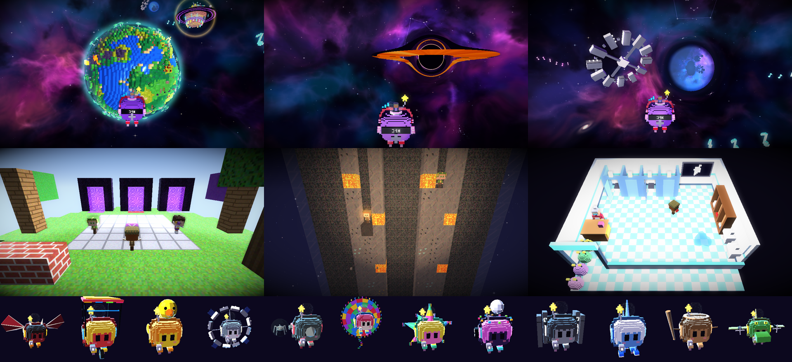

# Space Adventure



Un sistema solar de juguete, todo en voxels, que la Nave Lila recorre
libremente. La nave es una idol alienígena (su cabeza gigante es el cuerpo) y
la maneja el piloto que uno escoja desde una burbuja de vidrio: el Chavo del
8, el Doctor Simi, Shrek, Steve, la Chilindrina, Doge, Mario, Patricio, el
Creeper, Kirby, el gato que grita, Pikachu, el Chapulín Colorado, Ugandan
Knuckles, y tres secretos (el profe Koch, Vegetta777 y Willyrex, que no se ven
en el casillero hasta desbloquearlos o comprarlos en la tienda)... o Miku, la piloto original. (Abajo, donde dice "Miku", va el
personaje escogido: el juego le cambia el nombre en todos los diálogos.)

## Para la entrega: requisitos y menú de puntos

**Proyecto individual:** _(nombre y carné)_ ([@fatupopzz](https://github.com/fatupopzz)). Todo el
proyecto (el pipeline, los planetas, la nave, los minijuegos, los modelos y la interfaz) es de una
sola persona.

**Uso de IA y recursos externos:** el proyecto se programó con ayuda de un asistente de IA
(Claude Code, de Anthropic) para escribir, revisar y depurar código; el autor revisó y
puede explicar todo lo que se entrega. Los recursos externos (fuentes, sprites de interfaz y de
iconos de controles) están en [Créditos](#créditos); todos los modelos 3D son
propios (scripts de `herramientas/`).

**Video del recorrido:** `cargo run --release -- --demo` hace el recorrido solo (unos 35
segundos), con piloto automático y un rótulo en cada parte: vuelo espacial a velocidad de crucero,
acercamiento al Planeta Chapín por su lado de día (frenando poco a poco, sin pantalla de carga: es
el mismo mundo), una vuelta completa en modo órbita (con cámara de cine: el planeta siempre en
cuadro, del día a la noche y de vuelta) y alejamiento. Con cualquier tecla de vuelo se toma el
control. Basta grabar la pantalla.

### Requisitos (habilitan la evaluación)

| Requisito | Dónde |
|---|---|
| Pipeline propio, sin el 3D de raylib | [src/pipeline.rs](src/pipeline.rs): vertex shader, clipping, rasterización, fragment shaders, z-buffer, stencil. raylib solo abre la ventana, lee el teclado/control y muestra el framebuffer. |
| Sol, nave propia y planetas que orbitan y rotan con el tiempo | [src/escena.rs](src/escena.rs): `posicion(t)` y `matriz(t)` dependen de los segundos, no de los cuadros. La nave sale de `herramientas/generar_nave.py`. |
| Acercarse a la superficie y alejarse sin cambiar de escena | En el espacio, con la cámara libre; el LOD pone el modelo detallado de cerca. |
| Modelos con M, V, P y prueba de profundidad; fragment shader propio | [src/obj.rs](src/obj.rs) lee los `.obj`; `fragment_shader` en [src/pipeline.rs](src/pipeline.rs). |
| Código, modelos, instrucciones y video | Este repositorio, [Correrlo](#correrlo) y el video grabado con `--demo`. |

### Menú de puntos (200)

| Característica | Pts | Dónde se ve y cómo se demuestra |
|---|---|---|
| Planetas distinguibles que orbitan, rotan y se ven de cerca (5) | 50 | Mercurio (cráteres), Tierra (continentes, nubes y la Luna), Marte (Monte Olimpo y rover), Júpiter (bandas y la Gran Mancha Roja), Saturno (anillos), Urano (acostado a 98°), Plutón (su corazón), el Planeta Hada, el Planeta Vegetta (un cubo de bloques) y el **Planeta Chapín**. |
| Tipos de modelo propios sobre un planeta (4) | 20 | En el **Planeta Chapín**: ceiba, roca volcánica, casita de Antigua, Templo I de Tikal y Arco de Santa Catalina ([herramientas/generar_chapin.py](herramientas/generar_chapin.py)). |
| Distribución procedural reproducible con ruido | 10 | `sembrar` en [src/chapin.rs](src/chapin.rs): puntos al azar con la semilla y campos de ruido Perlin ([src/ruido.rs](src/ruido.rs)) para la selva, los pueblos y la pendiente. Misma semilla, mismas ubicaciones; junto al Chapín, **F5/F6** cambian la semilla en vivo. |
| Posición y orientación sobre la superficie curva mientras rota | 5 | `colocar` y `Rejilla::superficie` en [src/chapin.rs](src/chapin.rs): cada objeto crece hacia afuera del planeta (su "arriba" es la dirección desde el centro) con un giro al azar, y se para justo donde esa línea toca los voxels (una matriz por nivel de detalle, porque el suelo cambia un poquito). Se dibuja con `M_planeta · local`, así gira con el planeta. |
| Shaders propios distintos (4) | 24 | `Shader` en [src/pipeline.rs](src/pipeline.rs): **Blinn-Phong** con luz de borde (todo), **cel shading** (estilo "dibujado" en Ajustes), **Terreno** (el color de cada voxel con variación por bloque, mapa de normales y lava, el Chapín), **Océano** (olas y Fresnel, el mar del Chapín) y **Plasma** (el Sol y el disco de Gargantúa). Además, un shader de pantalla: el **lente gravitacional** de Gargantúa y del agujero de gusano (`post::lente`). |
| Shader animado | 8 | El **Plasma** del Sol (fBm animado con *domain warping*), las olas del mar y la lava de los volcanes del Chapín. |
| Mapeo de normales | 8 | El terreno del Chapín: un mapa de normales hecho al arrancar (`mapa_normales`: una cara de voxel con la orilla biselada y un granito de ruido) que se lleva al mundo con la TBN de cada cara, así cada bloque se lee como bloque. **F9/F10** cambian su fuerza en vivo (0 lo apaga). |
| Deformación de un planeta con ruido | 10 | **Todos los planetas.** Cada uno tiene su superficie deformada con ruido: `r(d) = 1 + forma(d) + amplitud · fBm_Perlin(d · frecuencia)` (`Receta::relieve` en [src/planetas.rs](src/planetas.rs)), con su propia amplitud, frecuencia y semilla: los cráteres de Mercurio, los continentes de la Tierra, las montañas de hielo de Plutón, las burbujas del Sol, los cerros de Planeta Vegetta. En el Chapín ([src/chapin.rs](src/chapin.rs)) es un fBm para los continentes, "crestas" para las cordilleras y una cadena de volcanes con cráter. **En vivo, en cualquier planeta**: junto a él, **F7** baja el relieve hasta 0 (queda una esfera de voxels lisa: la misma generación, sin deformar), **F8** lo sube (hasta el triple) y **F5/F6** le cambian la semilla del ruido; se vuelve a armar ahí mismo. Lo prueban `el_ruido_deforma_a_todos`, `sin_relieve_cada_planeta_es_una_esfera` y `sin_relieve_es_una_esfera_y_el_ruido_la_deforma`. |
| Generación o subdivisión procedural de geometría | 10 | **Ningún planeta es un `.obj`**: el juego los arma todos al arrancar ([src/planetas.rs](src/planetas.rs), y el Chapín en [src/chapin.rs](src/chapin.rs)), en paralelo. Antes de rasterizar, llena una rejilla de voxels alrededor de cada esfera según su relieve deformado, le pone a cada voxel su material (las franjas de Júpiter, el corazón de Plutón), le agrega sus extras (el Monte Olimpo y el rover, las nubes de la Tierra, el anillo de Urano, los hongos del Hada, las prominencias del Sol), saca solo las caras que dan al aire y junta las vecinas iguales en rectángulos (*greedy meshing*). Lo único que sigue siendo modelo es lo que no es planeta: las caras de Neptuno y Plutón y el escenario de Saturno Ritmo. |
| Modo de control local para rodear un planeta | 8 | **R** (o B en el control) junto a un planeta: **modo órbita**, la nave sigue la curva a la misma altura y las flechas la suben o la bajan. Además, cerca de un planeta la nave se mueve con él en su órbita y la velocidad máxima baja con la distancia a la superficie. |
| Aceleración, frenado y giro progresivos | 8 | [src/nave.rs](src/nave.rs): suavizado exponencial `1 - e^(-k·dt)`, igual a cualquier framerate. |
| Atracción gravitatoria | 10 | `GRAVEDAD` en `Juego::actualizar` ([src/main.rs](src/main.rs)): `a = G·M/d²` hacia cada planeta cercano; el tablero dice cuánto jala ("jalón"). |
| Colisión con los planetas | 4 | [src/colision.rs](src/colision.rs): contra el terreno de verdad de cada planeta (su radio deformado en la dirección de la nave: montañas, cráteres, volcanes), y los anillos de Saturno y Urano como discos. |
| Descartar objetos fuera de la vista | 7 | `fuera_de_vista` en [src/pipeline.rs](src/pipeline.rs): la esfera de cada objeto contra los 6 planos del frustum, antes del vertex shader; y los objetos del Chapín del otro lado del planeta. **TAB** muestra los objetos y triángulos procesados; **V** apaga el descarte para comparar. |
| Niveles de detalle según la distancia | 8 | **Cada planeta se arma en 5 niveles** de voxels (de 0.75 a 3.25 veces su tamaño normal; el Chapín, de 16 a 64 de lado a lado) y se dibuja el que toca según cuánto mide en pantalla (`planetas::nivel_para`, el mismo para todos): de lejos, voxels grandes. Las ceibas y rocas del Chapín tienen versión de lejos, y lo que mide menos de 3 píxeles no se pide. En **TAB**: los triángulos procesados y en qué nivel va el planeta de junto. |
| Coherencia visual y claridad | 10 | Ver capturas en `previews/`, los controles en **TAB** y las ayudas en pantalla. |

Para pedir cambios en vivo durante la presentación: junto a **cualquier planeta**, F5/F6 le
cambian la semilla del ruido y F7/F8 el relieve (se vuelve a armar ahí mismo; el panel de TAB
dice cuáles tiene), y F9/F10 la intensidad de los shaders. En el código: las recetas de cada
planeta en `RECETAS` de [src/planetas.rs](src/planetas.rs) (amplitud, frecuencia y semilla del
ruido), los parámetros del Chapín en `chapin::PARAMETROS`, los radios y velocidades orbitales en
la tabla `CUERPOS` de [src/escena.rs](src/escena.rs) y la gravedad en `GRAVEDAD`.

## Personajes y pase espacial

- **Personajes** (en el menú principal): un casillero como el de Fortnite con
  los 26 pilotos. Cada tarjeta tiene el retrato 3D del personaje (pintado por
  el rasterizador al arrancar); los que faltan salen oscuros, con el nivel en
  que se desbloquean. A la derecha, el escogido baila en una vitrina.
  Todos los modelos los arma `herramientas/generar_personajes.py` con el mismo
  esqueleto chibi de Miku (mismas partes por nombre: `torso*`, `brazo_*`,
  `muslo_*`, `coleta_*`, `cara_*`...), así que cualquiera pilota, baila,
  aterriza y hace caras en todas las escenas. El Creeper, Steve y el gato que
  grita traen su propia cara fija.
- **Pase espacial · Temporada 1: Odisea Brainrot**: 40 niveles con premio cada
  uno: personajes, skins de nave, estelas, notas y **títulos** ("Piloto sin
  licencia", "NPC con aura", "Delulu galáctico", "Aura farmer", "Main
  character", "Sigma del espacio", "Rizz interestelar", "El GOAT del sistema
  solar"), que se equipan en el pase y salen en el HUD debajo de donde anda uno.
  Solo del pase: la estela **Six seven** (un 6 y un 7 de píxeles que se turnan),
  la skin **Setup gamer RGB** y, de gran premio en el nivel 40, el piloto que no
  se vende: **Chimpanzini Bananini**. La XP sale de lo que se hace jugando: 5 por nota
  recogida, 40 por logro, 120 por sello, 60 por encargo y 80 por cometa. Se
  calcula de la partida, así que una partida vieja ya trae su nivel. Al subir
  sale el aviso con el premio; una skin o estela que ya se tenía se cambia por
  notas.
- **El menú del juego tiene pestañas**, como Fortnite: JUGAR (la pausa; en el
  menú principal, INICIO), PERSONAJES, PASE, TIENDA y AJUSTES. ESC u
  Options/Menu lo abre en JUGAR, Q / E o L1 / R1 (LB / RB) pasan de una
  pestaña a otra, y ESC lo cierra. Las pestañas con algo nuevo (un personaje
  desbloqueado, un nivel del pase, algo que ya alcanza en la tienda) llevan un
  puntito rosa.
- **Controles**: el juego reconoce si el control es de PlayStation o de Xbox
  y dibuja los botones con su símbolo (✕ ○ □ △ con sus colores, o la A, B, X
  y Y en sus círculos verde, rojo, azul y amarillo), más L1/R1, Options o
  LB/RB, Menu. En el teclado, las teclas.
- **Vibración**: por SDL2 en modo HIDAPI (directo al DualSense o DualShock,
  sin pasar por el framework de controles de macOS, que se tragaba la
  vibración). `--probar-vibracion` dice qué control ve SDL y lo hace vibrar.

Están el Sol, Mercurio, Venus (gira al revés), la Tierra (23.5°) con la Luna
orbitándola, Marte con su volcán y un rover, Júpiter con su mancha roja,
Saturno Ritmo, Urano acostado a 98°, Neptuno, Plutón con su corazón, el
Planeta Hada, que tiene en su cueva un portal a una dimensión de bolsillo
(se ve solo a través de él, con el stencil buffer), y el Planeta Vegetta, un
cubo de bloques con su arbolito y la casita de techo morado. Empieza con una intro en una estación que orbita la Tierra:
Miku saluda con un guiño, baila con los fans y sus barras de luz, hace un
corazón con los brazos, gira y brinca a la burbuja de la nave, que se
despierta y despega entre fuegos artificiales.

Se puede aterrizar en cualquier planeta, y cada aterrizaje es una cutscene
como en los juegos: las órbitas se congelan, la cámara corta entre tomas
fijas (plano general viendo llegar la nave, contrapicado a ras de suelo),
hay franjas de cine y la tarjeta con el nombre del planeta, la entrada a la
atmósfera brilla del color de cada planeta, los motores levantan polvo al
acercarse al suelo y al tocar hay rebote y sacudida (se salta con
`ESPACIO`). La nave se posa sobre él (los planetas son de juguete, así que queda como El
Principito) y Miku se baja a saludar mientras la IA cuenta un dato del
planeta. Todos tienen escena (los once planetas, la Luna y el Planeta Vegetta):

- **Mercurio**: el consultorio de tarot de **Madame Mercurio**, que es el
  planeta mismo de adivina (cabeza gris con cráteres, turbante con gema, las
  alitas del dios Mercurio y aretes de argolla), en una carpa a rayas sobre
  el suelo gris y con cráteres, con el Sol enorme pegado a la ventana. Miku
  escoge tres cartas del abanico (pasado, presente y futuro); cada una vuela,
  da la vuelta y flota frente a la cámara mientras Madame **levita** y la lee.
  La baraja tiene **22 cartas** propias (El WiFi, La Camioneta, El Ex, El
  Parcial, El Chucho, La Tortilla, El Volcán, El Z-Buffer, La Muerte, El
  Tráfico, El Café, La Lluvia, El Quetzal, El Compilador, El Chisme, El
  Pisto...), pintadas por `herramientas/arte_tarot.py` como una baraja
  ilustrada (marco crema con filo dorado, número romano, fondo con rayos,
  ilustración con sombras y el nombre en un listón; se pintan 4 veces más
  grandes y se reducen, para que salgan suaves) en un atlas de 8 x 3. Las
  que salen por primera vez llevan el letrero **¡CARTA NUEVA!** y el juego
  lleva la cuenta de las descubiertas. Madame **amanece cada vez de un
  humor**: de buenas, **de malas** (dice verdades que duelen después de cada
  carta y salen más invertidas), dormida (bosteza y ronca) o dramática (todo
  es telenovela y caen rayos). Una vez por lectura **Mercurio entra en
  retrógrado**: la pantalla se pone como un VHS rebobinando, la carta regresa
  al abanico por el mismo camino, lo último que dijo Madame se lee al revés,
  la música suena al revés y el Sol de la ventana hace el rizo de la
  retrogradación; la carta que se saque después sale invertida. Al final las
  tres cartas suman su suerte y cae el **sello del veredicto**: con
  BENDICIÓN regala una luna de Júpiter para la mochila; con BUENA SUERTE,
  notas de propina; con **SALAZÓN** llueve sal (con el salero sacudiéndose),
  las velas se ponen verdes y a la nave le cae la **maldición del
  retrógrado**: al volar, los controles van al revés un rato... a menos que
  se pague una **limpia con huevo** (o, sin notas, una limpia de pobre con
  tortilla, que quita la mitad).

- **Venus**: el planeta del amor... y por eso, del **juzgado de divorcios**
  (465 grados y lluvia de ácido, como todo buen divorcio). Hoy se divorcia
  Saturno: tiene tres anillos principales (A, B y C, los de verdad) y cada uno es de una boda:
  sus tres ex lo demandan para quedarse con el anillo de su boda. Son
  **Sonic** (se casó por los anillos, obvio), **Gollum** (su tesssoro) y
  **el Sinluz** de *Elden Ring*, que no habla: testifica con mensajes en el
  piso («anillo C, por lo tanto, el más brillante»). Los representa
  **Phoenix Wright** y el juez es **el ganso de *Untitled Goose Game***, con
  peluca. Se juega como *Ace Attorney*: cada ex da un testimonio de cuatro
  declaraciones y una es mentira; Miku, la abogada de Saturno, las recorre
  con las flechas, las compara con el expediente (datos reales de cada
  anillo: el B es más del 90% hielo, el A está hecho de miles de anillitos,
  el C es el más oscuro, se le están cayendo a Saturno como lluvia...), puede
  presionar para que le cuenten más y, cuando encuentra la mentira, grita
  **¡PROTESTO!** (con la burbuja, el zoom y el golpe). Si protesta mal, al
  juez se le acaban las plumas de paciencia y el anillo se lo lleva el ex...
  Cada caso trae **tres pruebas** en desorden (arriba / abajo para verlas) y
  hay que protestar con la declaración falsa *y* el documento que la
  desmiente. Además de los testimonios sobre los anillos (que se desmienten
  con la ficha astronómica), hay casos de **bodas inventadas al azar**: el ex
  dice dónde, cuándo, quién fue el testigo y cómo era el pastel, y una de las
  cuatro cosas choca con el acta de matrimonio, la foto de la boda o el
  recibo de la pastelería. Ganar tiene su consecuencia (el Registro Civil de
  Titán abre un expediente, la pastelería cobra el pastel que nunca
  existió...). Antes del primer interrogatorio sale una tarjeta de cómo se
  juega, y si se protesta mal aparece una pista.
  o se lo roba el ganso y se lo pone de collar. Los anillos que pierde
  Saturno desaparecen de su modelo. El orden de los ex y sus
  testimonios cambian en cada juicio. Al final lo
  declaran DIVORCIADO (y Saturno invita a la fiesta de divorcio en su concierto).
- **Tierra**: la nave se posa en el parqueo de la **UVG** y se escoge a dónde
  ir (dos tarjetas: con las flechas, el número o el ratón): el **lab del CIT**
  o el **salón de Teoría**.

  **11:59, la noche antes de la entrega** (el lab). Son las 23:00 en el
  laboratorio de cómputo del CIT (UVG), llueve, y a las 23:59 se entregan los
  tres proyectos del profe Koch. El reloj corre de verdad (la hora del juego
  son seis minutos; el reloj de pared del lab marca la hora). Cada proyecto es
  una pestaña de la compu con su minijuego:
  **Gráficas** (el render del proyecto 3 sale roto: de cabeza, estirado, sin
  z-buffer, por dentro, con la luz al revés, en alambre, en puntos, con el FOV
  a 150°, con el plano cercano lejísimos o con las matrices al revés; el render
  es **de verdad**, lo dibuja el mismo rasterizador con el bug puesto, y hay
  que escoger el arreglo), **Teoría** (un AFD al que le faltan transiciones; al
  completarlo corren las pruebas y una bolita recorre el autómata) y
  **Software 2** (conflictos de merge con el test que falla: lo suyo, lo del
  compañero o las dos). Mientras tanto la energía se acaba (hay que ir por café
  a la máquina del fondo, y a veces está agotada), el grupo de WhatsApp no se
  calla (se puede silenciar) y pasan cosas: Windows se quiere reiniciar, **se va
  la luz** (solo quedan las pantallas y el guardia entra con su linterna), se
  cae GitHub, Koch cambia la rúbrica, un compañero pide ayuda (si se le ayuda,
  a las 23:55 pasa sus apuntes), llega pizza, y **Koch llama por Teams** (sale
  como holograma en el proyector) con una pregunta de Teoría o de Gráficas. En
  el último minuto el lo-fi se acelera y la pantalla late en rojo. A las 23:59
  Koch pone las tres notas. Se juega con teclado, control **o ratón** (es una
  compu: se le puede dar clic a todo).

  **Spin-off: el examen de Koch** (el salón). El protagonista se sienta en un
  pupitre del salón de Teoría de la Computación (con un AFD de `(a|b)*abb` en
  el pizarrón) y el profe Koch hace cinco preguntas de autómatas, sacadas al
  azar de un banco de veinte (AFD y AFN, lema de bombeo, Thompson, CYK,
  Chomsky, Turing...). Si la respuesta está mal, Koch camina hasta el pupitre,
  alza la regla y **¡REGLAZO!**: el brazo y la regla giran juntos en el codo
  (una matriz por parte), la cámara tiembla, el protagonista queda con los ojos
  en espiral y suelta su queja, y la pantalla se pone roja en los bordes. Con
  cada error Koch espera más cerca; con tres, reprobado por la vía rápida.
  GLADAS comenta cada respuesta y después de contestar se explica por qué. Al
  final sale la nota con estrellas, y se puede repetir con otras preguntas.
- **La Luna**: un **set de filmación** de "la llegada a la Luna" (una broma
  con la teoría de que fue falsa). Un director con boina y megáfono grita
  "¡CORTE! ¿Quién dejó pasar esa nave?" y pone a Miku a revisar la toma: por
  cada cosa sospechosa hay que decidir si es **del set** (se quita: el
  ventilador que hace ondear la bandera, el café, el reflector, el micrófono
  en cuadro, el letrero de SALIDA, el profe Koch de extra) o si **así
  es la Luna** de verdad (el cielo sin estrellas, la Tierra enorme, las
  huellas perfectas, los saltos en cámara lenta: justo los "argumentos" de la
  conspiración). GLADAS da el dato real de cada una. Si te equivocas, pintan
  estrellas de cartulina, barren las huellas o le ponen cables al astronauta.
  Al final, "¡Y... ACCIÓN!", y la cámara se aleja: el set está **en la Luna de
  verdad** (salía más barato que un estudio), con el módulo lunar, la Tierra
  en el cielo y la nave estacionada. GLADAS aclara que la llegada de 1969 sí
  fue real. Cada toma escoge seis sospechas al azar.
- **Marte**: *Doki Doki Marte*, un simulador de citas. Curiosity lleva solo
  en Marte desde 2012 (en 2013 se cantó feliz cumpleaños él solito), así que
  Miku le hace de celestina. Se elige a una de las cuatro solteras del
  planeta (Ingenuity, la helicóptera con la hélice quebrada; InSight, la
  sismóloga dormida por el polvo; Perseverance, la nueva; o Sojourner, la
  abuelita de 1997) y se contesta por él. Cada cita es distinta: de las cinco
  preguntas de cada una salen tres al azar, con las respuestas revueltas y un
  saludo distinto. Hay cinco finales: boda en Marte (todo perfecto, con Miku
  de oficiante), cita exitosa, friendzone, Curiosity cantándose feliz
  cumpleaños otra vez (pero ahora con Miku), y drama en Marte: si ya salió
  bien con una y sale bien con otra, la ex llega a reclamar. El final no
  depende solo de los corazones, sino de **cómo se portó Curiosity**: si
  arrancó mal y remontó, con menos corazones sale bien; si arrancó perfecto
  y metió la pata al final, la cita baja un escalón (lo último es lo que
  ella recuerda). GLADAS lo comenta al cierre. Todo pasa en un picnic al
  atardecer, que en Marte es azul. Antes de la primera pregunta se escoge un
  **regalo** (a cada una le encanta uno y odia otro: a InSight que le soplen
  el polvo de los paneles, a Perseverance una piedra para sus tubitos; a
  Perseverance, que es nuclear, los paneles le dan igual) y casi siempre pasa
  un **momento sorpresa** a media cita: una tormenta de polvo (el cielo se
  pone naranja), Fobos cruzando el cielo con estrellas fugaces, Houston
  llamando para que taladre una piedra, Miku que se ofrece a cantar o el
  atardecer azul. Y si Curiosity le sale bien a dos en la misma visita,
  llega la ex, se ponen de acuerdo y le dan una **golpiza** (nube de polvo,
  ¡PAF! ¡POW! de historieta): **GAME OVER**, Curiosity en modo seguro.
- **Saturno**: Saturno Ritmo en vivo. Miku canta sentada en una luna que se
  mece sobre el escenario hexagonal, con reflectores, el ecualizador latiendo
  y los anillos girando como un vinil. Desde ahí se juega el **minijuego de
  ritmo**: la nave se para en la puerta de juicio sobre el anillo y los
  bichitos-nota llegan en dos carriles (piso y aire) al ritmo de la canción.
  Como en Project DIVA, Taiko u osu!: se elige dificultad (FÁCIL con un solo
  botón y solo las notas fuertes, NORMAL, o DIFÍCIL con la partitura
  completa), cada golpe suena (el "don" del piso y el "ka" del aire), sobre
  la puerta hay anillos que se encogen hasta el momento justo, y cada acierto
  dice si fue temprano o tarde.
- **Neptuno**: noche de cartas. Se juega **¡NEPTUNO!** (como UNO, pero con
  viento): Miku contra el Doom Slayer, el Master Chief y Cloud Strife en
  versión chibi, con Neptuno de anfitrión gigante flotando detrás de la mesa.
  Reglas completas (108 cartas, Salta, Reversa, +2, Comodín, +4), y si te
  queda una hay que gritar "¡NEPTUNO!" o robas dos. Lo de Neptuno: cada
  tantas jugadas sopla una ráfaga de 2,000 km/h que le vuela una carta a
  alguien y se la lleva al siguiente. Y a veces llegan visitas: Canela (de
  Animal Crossing) entra corriendo a decirle al Doom Slayer que Tom Nook lo
  busca por la hipoteca; el Slayer se va y Canela juega por él (muy amable:
  casi nunca tira +2) hasta que regresa. O Plutón llega rodando a pedir que
  lo dejen jugar. Las cartas son modelos 3D: un solo
  `carta.obj` trae los 5 colores y los 15 símbolos, y cada carta se dibuja
  ocultando las partes que no son.
- **Júpiter**: **Jupiter Asteroids** en primera persona, desde la cabina de
  la Nave Lila: un tablero de tres paneles con su visera y una línea de luz,
  pilares de la burbuja, una palanca que se inclina con el viraje y, en la
  visera, el muñequito cabezón del personaje escogido, que se bambolea con
  cada vuelta y cada golpe. El HUD va adentro de las pantallas del tablero
  (se proyectan sus esquinas): el escudo en segmentos y los poderes a la
  izquierda, un radar con las rocas y la tormenta al centro, los puntos a la
  derecha. Las rocas grises se parten, las rojas tumban notas en el espacio y
  las doradas traen un dato de **Bill Nye**; las **lunas de Galileo** son
  comodines (Io dispara fuego, Europa escudo, Ganímedes láser gordo, Calisto
  frena el tiempo) y se guardan en la mochila. Cada tres oleadas sale la
  **Gran Mancha Roja** de jefe.
- **Urano**: **el baño de Doña Chepa** (al estilo de *Overcooked*). El único edificio de
  Urano es un baño público y hoy hay feria: llega todo el sistema solar. Doña Chepa cobra desde su
  banco y usted hace todo lo demás, en vista desde arriba: cobrar Q1 en la caja (el cliente se va
  solo al primer cubículo libre; si no esperó mucho, deja propina), llevar papel del estante cuando
  alguien grita "¡PAPEL!", destapar inodoros con el destapacaños (apretando varias veces) y secar
  los charcos con el trapeador antes de que alguien se resbale (el resbalón le baja estrellas). Los
  clientes pierden la paciencia en la fila (los urgidos, más rápido) y si se les acaba se van
  enojados. Tres días cada vez más locos (lunes, viernes de quincena y domingo de feria, con la
  excursión del colegio de Plutón), con meta de quetzales y mínimo dos estrellas. Los clientes son
  aliens voxel de cinco colores, con cara feliz, urgida o enojada; las puertas de los cubículos
  giran en su bisagra (una matriz por parte).
- **Planeta Vegetta**: el **servidor de minijuegos** de Vegetta777 (homenaje a su serie de
  Minecraft con Willyrex). Se llega a un lobby, una isla flotante con el día pasando (de mañana a
  noche, con estrellas), Vegetta, Willy, el marcador de la tarde y **tres portales** de obsidiana;
  se camina a uno para jugar contra Willyrex:
  - **Parkour**: la carrera sobre islas flotantes, **distinta cada vez**: huecos, pilares de un
    bloque, slime que avienta, franjas de lava, arbolitos y puntos de control (el bloque morado
    de la V). Diamantes flotando (valen notas). Willy corre la misma pista y a veces se tropieza.
  - **TNT Run**: tres pisos de arena sobre TNT, al atardecer. Lo que se pisa se cae (con su TNT,
    dando vueltas) un instante después: hay que moverse siempre. Gana el último que siga arriba.
    Willy juega con la misma física: busca lugares con piso alrededor, salta huecos y a veces
    escoge mal.
  - **Minería**: dos pozos con el frente de vidrio, vistos de lado (como granja de hormigas), de
    noche y a la luz de las antorchas (una luz con alcance que titila). Se pica (mantener) hacia
    abajo o de lado: tierra, piedra, menas de carbón, oro y diamante, obsidiana y la roca madre al
    fondo. En las columnas de los lados hay bolsas de lava: quema (un rato sin moverse) y se
    vuelve obsidiana. El primero en llegar a la roca madre gana; los diamantes se cambian por notas.
  Los bloques tienen textura (un atlas de pixel art propio, 32 dibujos) y al picar o caerse
  sueltan pedacitos; lo que se está picando se va agrietando.
- **Planeta Hada**: la **Gran Fuente de las Hadas**, el Proyecto 2 (que era
  un raytracer de la fuente de *Ocarina of Time*) rehecho en voxels y
  rasterizado: la isla flotante, la plaza de baldosa celeste, la piscina
  hexagonal con el estrado y el cuenco, la Trifuerza del piso, las antorchas,
  las columnas, la aurora y la lluvia de brillos. Como Link en el Proyecto 2,
  Miku se para en la Trifuerza y toca la Canción de Miku con la ocarina
  (flechas y A); cada dos notas se enciende un triángulo. Con la canción
  completa, en vez de la Gran Hada sale del cuenco **Megurine Luka**
  cantando, con su tarjeta de título como en un spin-off (*La Fuente de
  Luka*): la Gran Hada se jubiló y le dejó la fuente. Bendice a Miku con
  polvo de hada, Miku levanta un Contenedor de Corazón y al final bailan
  juntas. Navi vuela alrededor. La música es original, de arpa (cuerdas
  pulsadas con Karplus-Strong).
- **Plutón**: junta de emergencia, en homenaje a los juegos de impostores.
  Plutón aprieta el botón rojo y el consejo llega a la mesa: cada planeta es
  un tripulante frijolito con visor, del color de su planeta y con su
  planetita flotando sobre la cabeza. Plutón da su discurso (se dibuja en
  **alambre** porque "desde 2006 ya no lo rellenan"), cada planeta opina y se
  vota si vuelve a ser planeta. El consejo queda empatado: decide la piloto.
  Si gana el sí, Plutón vuelve a dibujarse relleno y suena la canción.

Todo el sonido se sintetiza al arrancar ([src/sonido.rs](src/sonido.rs)): no
hay archivos de audio. La canción es original ([src/cancion.rs](src/cancion.rs))
y de su misma partitura salen las notas del minijuego. Los personajes hablan
con "blips" (GLADAS, la IA robótica de la nave; Miku aguda; el profe grave) mientras el texto
aparece letra por letra.

Todo se dibuja con un **rasterizador por software** escrito en Rust: raylib
solo pone la ventana, el teclado y una textura a la que se sube el
framebuffer cada cuadro. Las matrices, el clipping, la rasterización, la luz
y el z-buffer son código propio.

GLADAS, la IA de la nave, tiene modelo propio: una mezcla de Astro Bot
(cabeza blanca, visor negro con ojos LED que cambian de expresión, orejeras
de luz azul) y GLaDOS (la cápsula de atrás y el brazo mecánico del que
cuelga, los ojos amarillos). Cada vez que habla sale su retrato animado, que
es **render to texture**: el mismo pipeline la dibuja en un framebuffer
propio de 160×160 con su propia cámara, y esa imagen se pega en la interfaz.

## El Planeta Chapín: «¡Hay campo!» (la camioneta)

Al aterrizar en el Chapín se maneja una **camioneta extraurbana** (el bus escolar gringo pintado
de azul, amarillo y rojo, con su parrilla llena de costales) por la carretera a la capital, entre
ceibas y casitas de Antigua, con los volcanes al fondo y un **son de marimba** en 6/8 sintetizado
para el juego ([src/camioneta.rs](src/camioneta.rs), `sintetizar_marimba` en
[src/cancion.rs](src/cancion.rs)).

- Tres carriles: **A / D** (o el stick) cambian de carril; **W** le pisa y **S** frena.
- En las **paradas** (a la derecha) hay gente saludando: se sube si se va en el carril derecho y
  despacio. Cada pasajero paga Q5 al llegar a la terminal. El bus dice 40, pero siempre hay
  campo: caben 60.
- **Tuc-tucs** más lentos, **perros** que van y vienen en su carril y **baches**: chocar abolla
  la camioneta y se baja gente del susto; con tres abolladuras llega la grúa.
- Los **túmulos** atraviesan la carretera: pasados rápido, la gente sale volando y alguien se
  baja quejándose. Hay que frenar.
- El ayudante grita ("¡Hay campo, hay campo!", "¡Atrás hay lugar!", "¡Túmulo, chofer!") y siempre
  queda un carril libre (lo prueba un chofer automático con varias semillas).

## Las maravillas del sistema (homenajes)

Volando se encuentran homenajes a películas y libros de ciencia ficción, cada uno donde tiene
sentido ([src/maravillas.rs](src/maravillas.rs)); GLADAS cuenta qué es cada uno al acercarse, y cada
uno da un logro:

- **Interstellar.** Junto a Saturno (como en la película) flota un **agujero de gusano**: una bola
  de cristal donde se ve otra parte del cielo, de cabeza y azulada, con la **Endurance** girando al
  lado. Si se entra, la nave sale al otro lado del sistema, frente a **Gargantúa**: un agujero negro
  con su disco de acreción (con el shader de plasma) y la luz de las estrellas doblada alrededor.
  Gargantúa jala la nave; si se cruza el horizonte, se entra al **teseracto** (un librero de cinco
  dimensiones, en líneas doradas, con un acorde de órgano) y se sale junto a Saturno, como Cooper.
- **Project Hail Mary.** Del Sol a Venus brilla la **línea Petrova** (el astrófago, en infrarrojo),
  y junto a Venus está la **Blip-A**, la nave de Rocky, con su motor de astrófago encendido. Rocky
  está en su burbuja: al llegar habla con acordes (los eridianos hablan con música) y regala notas.
- **2001: Odisea del espacio.** Un **monolito** de 1 × 4 × 9 junto a Júpiter, a contraluz, con los
  metales y los timbales del amanecer de *Así habló Zaratustra*. Junto a él, **E** hace que GLADAS
  haga de HAL.
- **The Martian.** En el polo de Marte, junto al rover, hay un **huerto de papas** y el Hab.
- **La guía del viajero intergaláctico.** Si uno se va muy lejos y lo rescata la estrella, la
  pantalla dice **NO ENTRE EN PÁNICO**, en letras grandes y amistosas.
- **Mario Galaxy** (la estrella de rescate) y **Star Fox** (los barrel rolls) ya estaban.

**El lente gravitacional** es un shader de pantalla (`post::lente`, después de dibujar todo): el
píxel a distancia `r` del centro muestra lo que estaría a `r − θ²/r` (la fórmula del lente
puntual), así sale el anillo de Einstein y el disco de atrás se ve doblado arriba y abajo de la
sombra. Lo que está delante del agujero (por su profundidad en el z-buffer) no se dobla. El agujero
de gusano usa la misma idea al revés: adentro de su esfera, `r → θ²/r` (el cielo de atrás, de cabeza).

**El jugo de recoger** ([src/chispas.rs](src/chispas.rs)): cada nota suelta chispas de su color, un
aro de luz y un "+1" que sube; cada cinco del combo, "¡COMBO xN!" dorado que rebota; el contador de
notas late. Atrapar el cometa (y chocar con un asteroide) detiene el mundo una fracción de segundo
(*hit-stop*), destella y sacude la cámara.

## El pasaporte, los finales y las notas

Para que den ganas de volver a cada planeta:

- **Pasaporte espacial** (`P`, volando): cada planeta pone su **sello** al
  aterrizar, y cada escena tiene sus **finales y logros** (la boda en Marte,
  el reglazo del profe Koch, el Óscar de roca en la Luna, el ganso que se roba
  los anillos, todas las cartas invertidas en Mercurio, la nota S en DIFÍCIL,
  Canela en la partida de cartas...). Los que faltan salen como "???" con una
  pista. Al conseguir uno nuevo baja un aviso con sonido de sello. Son 90 en
  total, contando los trece sellos. Cuando una lista no cabe (el espacio tiene
  muchos), se acomoda en un renglón por logro.
- **Encargos de GLADAS**: siempre hay tres misiones cortas activas ("recoge
  20 notas", "haz un combo de 8", "aterriza en Neptuno", "atrapa un
  cometa", "consigue un final nuevo"...). Se cumplen solas mientras se
  juega, pagan notas y se cambian por otras: siempre hay algo que hacer.
- **Los minijuegos pagan** al despegar, según qué tan bien se jugó en esa visita
  (aviso "+N NOTAS · motivo"; `pago_de_escena` en [src/main.rs](src/main.rs)):

  | Minijuego | Paga |
  |---|---|
  | El baño de Doña Chepa (Urano) | 8 por día jugado, 15 por día cumplido, 30 si gana la semana |
  | Examen de Koch (Tierra) | 10 + 6 por respuesta buena, 20 más con 5 de 5 |
  | La entrega (Tierra) | el 45% del promedio, 20 más con los tres al 100 |
  | Saturno Ritmo | S 50, A 38, B 26, C 15 (×1.5 en difícil), 10 más sin fallos |
  | La cita de Marte | boda 50, éxito 40, amigos 25, drama 20, solo 10 |
  | Cartas de Neptuno | ganar 40, perder 12 |
  | Set de la Luna | 7 por acierto |
  | Divorcio de Venus | 15 + 8 por cada veredicto para Saturno |
  | Junta de Plutón / Fuente del Hada / Tarot de Mercurio | 25 / 35 / 15 |
  | Servidor de Vegetta | 5 por partida, 15 por partida ganada (más los diamantes, ×2) |
  | La camioneta (Planeta Chapín) | 5 por viaje, 1 por pasajero del mejor viaje, 15 si llegó a la terminal |
  | Júpiter Asteroids | 1 por cada 50 puntos (al terminar la partida) |

  Así todo lo que se juega sirve para juntar para la tienda, no solo volar.
- **Estelas**: las notas se gastan en estelas para la nave (cian,
  fuego, arcoíris, notas rosas y cian, corazones), que se compran y se
  ponen en el Mirador o en la tienda. Los logros de notas cuentan todas las
  recogidas, aunque se gasten.
- **Tienda** (en el menú principal): skins para la nave, estelas y
  **personajes**. Solo se venden los **extras**: lo que es premio del pase
  se gana solo subiendo de nivel. En la pestaña de personajes están los
  pilotos secretos, para no esperar a su logro (el profe Koch 400 notas,
  Vegetta777 y Willyrex 300), los pilotos de memes (**la capibara** con su
  mandarina 220, **Moo Deng** 240, **Pedro** el mapache 260, **Chill Guy** 280,
  **Tung Tung Tung Sahur** 300 y **Labubu** 320, cada uno con su forma de hablar
  y sus líneas en las escenas de la historia), y **Rocky** (350), el ingeniero eridiano de
  *Project Hail Mary*, que solo se compra: sin ojos, cinco patas, y habla con
  acordes (GLADAS traduce). Se pueden poner ahí mismo. Si la lista no
  cabe, se desliza con el cursor. Una
  skin es la misma nave con otros colores en sus materiales (`Kd` y `Ke`) y
  sus accesorios (el puerro, la bandera, el shuco, la taza de café...). Las
  **carrocerías** cambian la forma de la nave entera: platillo de Roswell
  (anillo con lucecitas), cohete del 69 (punta a franjas y aletas), tiburón
  espacial (aleta, cola y dientes), dragón del Volcán de Fuego (alas de
  murciélago, cuernos y cola), tuk-tuk interestelar (techo, postes y tres
  llantas), patito de hule gigante, la **Endurance** de *Interstellar* (el
  anillo de doce módulos alrededor de la nave, girando sobre el eje de vuelo)
  y la **Blip-A** de *Project Hail Mary* (casco de xenonita, motor de
  astrófago al rojo y la burbuja con Rocky adentro), el **barrilete de Sumpango**
  (papel de china, flecos y cola), la **piñata** de siete picos, la **bola disco**
  que gira en el techo, los paneles de **TARS** y el *brainrot* italiano:
  **Tralalero Tralala** (aleta y tres tenis azules), **Tung Tung Tung Sahur**
  (tronco con su bate), **Bombardiro Crocodilo** (hocico, alas y hélices que giran)
  y **Ballerina Cappuccina** (taza de capuchino y tutú). Las estelas nuevas:
  **Astrófago** (bichitos de luz infrarroja que laten) y **Teseracto** (marcos
  dorados que se abren detrás de la nave). Se arma una copia por skin al cargar. A
  la derecha, una vitrina la muestra girando (renderizada por el mismo
  rasterizador); en las estelas, la nave vuela en círculos dejándola.
- **Mochila** (una pestaña del menú): las lunas de Galileo que se traen de
  Júpiter (se usan volando: turbo de Io, escudo de Europa, imán de Ganímedes,
  cometa de Calisto) y un **recuerdo** por cada aventura, cada uno modelado en
  voxels (`herramientas/generar_recuerdos.py`): la carta de El Chucho, el
  anillo de bodas de Saturno (con un Saturno chiquito de piedra), la regla de
  Koch con un autómata grabado, la claqueta, la foto de la cita en Marte, la
  Gran Mancha Roja en un frasco de mermelada, el vinil, la carta +4, la
  credencial de planeta de Plutón (con su corazón), el Contenedor de
  Corazón, hielo de cometa, el corbatín firmado de Bill Nye, el cinturón de
  campeón de Urano, el bloque de diamante de Planeta Vegetta y el patito de
  Doña Chepa. Se ven en foto en la cuadrícula (los que faltan, en sombra) y el
  escogido gira en grande.
- **Notas en el espacio**: entre las órbitas flotan arcos de notas musicales
  que se recogen pasando por ellas. Recoger varias seguidas hace **combo**:
  cada nota suena un tono más arriba en la escala (pentatónica). Renacen al
  rato.
- **Cometas**: cada tanto cruza un cometa cerca de la nave (GLADAS avisa y un
  marcador en pantalla dice dónde está). Si se alcanza, vale 25 notas. La
  cola apunta lejos del Sol, como la de los cometas de verdad.

Todo se guarda en `partida.txt` (se puede borrar para empezar de cero),
junto con los ajustes.

## El Mirador y la historia del universo

El **Mirador** es el punto de descanso: una plataforma flotando en el punto
**L2** de la Tierra (del lado contrario al Sol, donde está el telescopio
James Webb), con una fogata con una espada clavada, como las hogueras de
Dark Souls. Se encuentra por su baliza rosa que parpadea y por su marcador
en el HUD; con `E` junto a él, Miku se sienta en la banca viendo la Tierra
(con el Sol asomándose detrás) y se recarga el turbo. Desde ahí se lee la
**bitácora de GLADAS** (18 entradas sobre cada lugar del sistema solar, que
se abren con su sello o su logro; la última, con el pasaporte lleno, cuenta
qué significa GLADAS), se revisan los encargos y se ve **la historia del universo**
(también desde el menú principal): una cinemática de diecisiete capítulos
narrada por GLADAS, hecha con partículas y los modelos del juego (con `←`
`→` se cambia de capítulo):

1. El Big Bang (un punto, el destello y la esfera que se expande y se enfría).
2. La primera luz: el fondo cósmico de microondas (una esfera de manchitas
   más calientes y más frías).
3. Las primeras estrellas, prendiéndose una por una.
4. Las galaxias (una espiral de dos brazos).
5. Las supernovas: la estrella se infla, se encoge y explota en colores (de
   ahí salen el hierro, el calcio y el oro).
6. Los agujeros negros: el disco que gira, más brillante del lado que se
   acerca, el anillo de luz y la parte de atrás del disco doblada encima.
7. El Sol: un disco de gas que cae en espiral y se prende.
8. Los planetas, saliendo del polvo del disco.
9. La Luna: Theia choca con la Tierra y los pedazos forman la Luna.
10. El cielo se vuelve azul: las cianobacterias llenan el aire de oxígeno.
11. La vida, y el asteroide de los dinosaurios.
12. 1969: la llegada a la Luna (la de verdad).
13. 2007: nace Hatsune Miku.
14. Hoy: la Nave Lila.
15. Andrómeda y la Vía Láctea se funden (dentro de 4,500 millones de años).
16. El Sol se hincha en gigante roja y se traga a Mercurio y a Venus.
17. El final: las estrellas se apagan una por una.

## El menú principal

El juego arranca en una **pantalla de título** (distinta a la pausa): el
logo SPACE MIKU inclinado, "Presiona ESPACIO", y luego las opciones en una
lista limpia abajo a la izquierda; el sistema solar gira atrás y Miku baila
en grande a la derecha (la dibuja el mismo rasterizador en su propio
framebuffer, con el fondo transparente). Ahí están: Continuar (si hay
partida guardada), Nueva aventura (con la intro), La historia del universo,
el Pasaporte, los Ajustes, los Créditos y Salir. Al empezar a volar (después
de la intro o con Continuar), la nave está flotando en el centro del muelle
de la estación, ya despierta y con los motores prendidos.

## Pausa y ajustes

`ESC` (o start) abre la pausa: continuar, los ajustes, volver al menú
principal o salir. Los **ajustes** (también desde el menú principal):
volumen general, de la música y de los efectos y voces; calidad (en compus
lentas, "rápida" dibuja a 640 x 360: el rasterizador es por software y cada
pixel cuesta); pantalla completa; HUD; cabeceo invertido (como en los
simuladores); **volar con el ratón** (el ratón gira, clic izquierdo acelera,
clic derecho turbo) y su sensibilidad; la velocidad de los diálogos (lenta,
normal, rápida o de golpe); y la **vibración del control**. Se guardan con
la partida. Miku también sale en grande en la pausa.

**Vibración**: raylib en escritorio no sabe hacer vibrar los controles, así
que el juego abre **SDL2** al arrancar (como plugin, con `dlopen`), si está
instalado (`brew install sdl2` en Mac): con eso vibran los DualShock 4, los
DualSense y los de Xbox, en los choques, el aterrizaje, el turbo, el
hiperespacio, las notas, el cometa, el ¡PROTESTO!, el mazo del juez... Sin
SDL2 el juego funciona igual, sin vibración.

Las órbitas van despacio (la Tierra tarda unos cinco minutos en darle la
vuelta al Sol): cerca de un planeta, la nave lo acompaña en su órbita para
que no se le escape, y así casi no se nota. El juego también
se pausa solo si la ventana pierde el foco, y encuentra sus archivos
aunque se abra desde otra carpeta. Los menús tienen un estilo inspirado en
los de Persona 3 (franjas diagonales y la opción escogida en una banda
inclinada), en los colores del juego.

La barra de acciones de arriba (aterrizar, el salto, el destino) se ve
siempre, aunque se oculte el HUD; lejos de todo dice "Ir a ... y aterrizar".
El texto va en Pixelify Sans cargado a varios tamaños (y al doble en
pantallas Retina, que se dibujan a su resolución real), para que cada letra
se dibuje a su tamaño y salga nítida. En Pixelify el 5 es igual a la S y el
0 igual a la O, así que esos dos dígitos se redibujan en el atlas del font
(un 5 con la parte de arriba recta y un 0 con diagonal). Los títulos (el logo,
los nombres de los planetas al aterrizar, ¡K.O.!, 23:59...) van en **04b_30**,
un font de pixel gordito: con contorno grueso, canto de letras de bloque,
sombra y dos tonos. Ese font no trae tildes, ñ, ¡ ni ¿, así que esas marcas se
dibujan encima de su letra, en la misma cuadrícula de píxeles ([src/ui.rs](src/ui.rs)).

En los ajustes, el **estilo de dibujo**: "dibujado" (la luz en bandas, como
caricatura, y sombras de contacto en los rincones) o el clásico.

Para navegar, cada planeta (y el Mirador) tiene un marcador con su nombre y
su distancia, y con `T` se escoge a dónde va el hiperespacio: el destino se
resalta y, si queda fuera de la pantalla, una flecha en la orilla apunta
hacia él.

## Correrlo

```bash
cargo run --release
```

Tiene que correrse desde la raíz del proyecto: los modelos se leen de
`modelos/`.

### Controles

Funciona con teclado o con control (Xbox, PlayStation o genérico).

| | teclado | control |
|---|---|---|
| volar | `A` `D` girar, `↑` `↓` cabecear | stick izquierdo |
| acelerar / frenar | `W` / `S` | `RT` / `LT` |
| turbo (gasta la barra) | `shift` | `RB` |
| barrel roll | `Q` | `Y` |
| salto al hiperespacio, aceptar | `espacio` | `A` (cruz) |
| aterrizar / despegar | `E` | `X` (cuadrado) |
| UVG (Tierra): el lab o el salón / entrar | `←` `→`, `1` `2` o el ratón / `espacio` (o clic) | cruceta / `A` |
| el examen de Koch: escoger / contestar | `↑` `↓` / `espacio`, o `1` a `4` directo | cruceta / `A` |
| la entrega (Tierra): cambiar de proyecto / escoger / hacer | `←` `→` / `↑` `↓` o `1` a `4` / `espacio` (o clic) | cruceta / cruceta / `A` |
| la entrega (Tierra): café / silenciar WhatsApp | `Q` / `shift` | `Y` / `RB` |
| Júpiter: moverse y apuntar / disparar | `A` `D` y flechas / `espacio` | stick / `A` |
| el baño de Urano: moverse / usar, agarrar o cobrar (trapear: mantener) | `W` `A` `S` `D` o flechas / `espacio` | stick / `A` |
| Planeta Vegetta (lobby, parkour y TNT Run): correr / girar / más rápido / saltar | `W` `S` / `A` `D` / `shift` / `espacio` | stick / stick / `RB` / `A` |
| Planeta Vegetta (minería): moverse de lado / picar (mantener) / saltar | `A` `D` / `F` (o clic) / `espacio` | stick / `R2` (`RT`, `ZR`) / `A` |
| Saturno Ritmo: piso / aire | `F` / `J` | `A` o `LB` / `B` o `RB` |
| votar en la junta, contestar en la cita | `1` a `3`, o flechas + `espacio` | cruceta + `A` |
| cartas: elegir / jugar / robar o pasar / ¡NEPTUNO! | `←` `→` / `espacio` / `↓` / `Q` | cruceta / `A` / `↓` / `Y` |
| set de la Luna: del set / así es la Luna | `1` `2`, o flechas + `espacio` | cruceta + `A` |
| juicio en Venus: otra declaración / presionar / ¡PROTESTO! | `←` `→` / `espacio` / `Q` | cruceta / `A` / `Y` |
| relleno / alambre / puntos / z-buffer / normales / UV / stencil | `1` a `7` | `select` |
| face culling | `C` | |
| info del pipeline y controles | `TAB` | apretar el stick izquierdo |
| pasaporte (sellos, finales y logros) | `P`, y flechas para cambiar de planeta | apretar el stick derecho |
| destino del hiperespacio | `T` | `LB` |
| pausa y ajustes | `ESC` | start |
| volar con el ratón (se activa en la pausa) | mover el ratón, clic izquierdo / derecho | |
| pantalla completa | `F11` o `Alt+Enter` | |
| ocultar el HUD | `H` | (en la pausa) |

`cargo run --release -- --captura foto.ppm [segundos] [x y z rumbo] [alambre|puntos|salto|entrega|entrega_graficas|entrega_teoria|entrega_software|entrega_teams|entrega_windows|entrega_luz|entrega_cafe|entrega_sueno|entrega_companero|entrega_rubrica|entrega_whatsapp|entrega_nervios|entrega_final|intro|concierto|ritmo|junta|junta_si|cita|cita_bien:<n>|cita_mal:<n>|cita_golpiza|cita_momento:<n>|neptuno|neptuno_juego|portal|gladas|fuente|fuente_hada|cometa|mirador|historia:<capítulo>|espacio_mirador|miku_menu|mercurio|mercurio:<fase>[~salazon|~bendicion|~nifu]|divorcio|divorcio:<fase>|luna|luna:<fase>|jupiter|jupiter_jefe|aula|aula_pregunta|aula_bien|aula_mal|aula_reglazo|aula_final|chapin|chapin_cerca|chapin_orbita|urano|urano_juego|urano_final|vitrina:<id,id,...>|vegetta|vegetta_carrera|vegetta_lobby|vegetta_tnt|vegetta_mina|demo:<segundos>|cerca:<planeta> [relieve:<x>] [semilla:<n>]|maravilla:<gargantua|gusano|blip|monolito|huerto|teseracto>|recoger|naves|estelas|aterrizar:<planeta>] [zbuffer|normales|uv|stencil]`
dibuja un cuadro sin abrir la ventana y lo guarda como imagen (sin la
interfaz). Para ver también la interfaz:
`cargo run --release -- --foto-ui foto.png [segundos] [escena...] [mensaje] [info] [completa]`
abre el juego en esa escena, saca una foto de la ventana y se cierra (con
`menu`, `menu_lista`, `pausa` o `pasaporte`, sobre esa pantalla).

### El manejo

Toma ideas de juegos de naves:

- **Crucero y gravedad** (como No Man's Sky o Elite): la velocidad máxima
  depende de qué tan lejos está la superficie más cercana. En el vacío la nave
  llega a 1,500 km/s; junto a un planeta, su gravedad la frena sola para poder
  maniobrar y aterrizar.
- **Órbita sincronizada** (como Outer Wilds): cerca de un planeta, la nave se
  mueve con él en su órbita, así no se le escapa mientras uno se acerca.
- **Turbo con barra y barrel roll** (como Star Fox).
- La cámara se queda más atrás y el FOV se abre con la velocidad.
- **Que no se sienta tosca**: la velocidad de giro persigue a la que se pide
  con un suavizado exponencial (`1 - e^(-k·dt)`, igual a cualquier framerate;
  ver *Lerp smoothing is broken*, de Freya Holmér), así el teclado (que solo
  sabe 0 o 1) no da tirones. El ratón mueve la nariz directo (como en un
  shooter) y los sticks tienen curva (poquito movimiento, poquito giro). La
  nave se ladea según qué tan rápido gira de verdad, y la cámara se ladea un
  poco con ella y se adelanta hacia donde va la vuelta.
- **Como en Mario Galaxy**: si uno se aleja demasiado del sistema solar, la
  gravedad jala de regreso (con un aviso); y si se sigue, una **estrella de
  rescate** cierra la pantalla, trae la nave junto al planeta de la orilla y la
  vuelve a abrir.

En el baño de Urano el protagonista arranca y frena suave (su velocidad persigue
a la pedida, igual a cualquier framerate) y el botón hace lo que corresponde a lo
que tiene enfrente (cobrar, agarrar, poner papel, destapar o trapear), con el
letrero de lo que va a pasar encima de su cabeza. En Planeta
Vegetta el salto también tiene buffer y coyote time, y soltar el botón subiendo
lo corta (salto chiquito).

El sistema está agrandado 3 veces respecto a la nave (`ESCALA_SISTEMA` en
[src/escena.rs](src/escena.rs)), así que la nave se ve chiquita junto a los
planetas. Cada planeta tiene dos niveles de detalle (**LOD**): el ligero de
lejos y uno con voxels 2.5 veces más finos, relieve (cráteres hundidos,
continentes y montañas, mares lunares, el cañón de Marte) y nubes
transparentes en la Tierra, que se dibuja cuando el planeta mide más de 70
píxeles de radio en pantalla.

El cielo es una nebulosa calculada una vez al arrancar (en seis hilos) y
guardada en un cubemap de 512 ([src/cielo.rs](src/cielo.rs)): nubes de violeta
a magenta a rosa torcidas con *domain warping* (el ruido deforma al ruido),
**filamentos** de gas (ruido "con crestas"), nudos brillantes donde nacen
estrellas, velos turquesa, carriles de polvo oscuro y la franja de la galaxia;
con galaxias espirales lejanas, unas 5800 estrellas de colores y cúmulos que
titilan (las más brillantes con halo y destellos en cruz, y todas se estiran
en rayas en el hiperespacio), constelaciones con forma de corazón, nota
musical, estrella y gatito, y estrellas fugaces. El Sol echa **rayos de luz**
(que cortan los planetas y la nave que se le pongan enfrente), cada planeta
tiene el **anillo de su atmósfera** de su color, y la imagen pasa por una
**gradación de color** (más saturación, curva en S, sombras hacia el violeta).

## El pipeline

Está en [src/pipeline.rs](src/pipeline.rs) y sigue las etapas del curso
(*Render Pipeline*, CC2018): Aplicación → Vertex Shader → Primitive Assembly
y Clipping → Rasterización → Fragment Shader → Operaciones por fragmento →
Framebuffer. Las dos programables (vertex y fragment shader) son funciones de
Rust; las "fijas" también están escritas a mano.

| Etapa | Qué hace aquí |
|---|---|
| **Aplicación** (CPU) | Arma los **draw calls**: un modelo, sus uniforms y su configuración (expresión, partes ocultas, modo de dibujo, uso del stencil) ([src/main.rs](src/main.rs)). Para cada planeta elige el nivel de detalle (LOD) según su tamaño en pantalla. Los mundos de bloques de Planeta Vegetta se arman en triángulos al entrar ([src/obra.rs](src/obra.rs)), la pista de parkour distinta cada vez, y se vuelven a armar cuando algo se cae o se pica. **Los planetas también se arman aquí**, al arrancar: voxels deformados con ruido y sus dos niveles de detalle ([src/planetas.rs](src/planetas.rs); el Chapín, con cinco niveles y en vivo, en [src/chapin.rs](src/chapin.rs)) |
| **Uniforms** | Lo que es igual en todo el draw call: las matrices M, V y P, la posición de la luz y de la cámara, la luz ambiente y la de borde. El tiempo entra como uniform en las animaciones (las llamas, el ecualizador que late con el ritmo) |
| **Atributos** | Por vértice, del `.obj`: posición (`v`), normal (`vn`) y coordenada de textura (`vt`) ([src/obj.rs](src/obj.rs)) |
| **Vertex shader** | `P · V · M · v` hasta clip space. Las **normales** van con la **inversa transpuesta** de M, `(M⁻¹)ᵀ n` ([src/matematica.rs](src/matematica.rs)): importa porque hay escalas no uniformes (las llamas se estiran en un eje). Devuelve los *varyings*: posición en el mundo, normal y UV |
| **Primitive assembly** | Triángulos rellenos, solo aristas o solo vértices (`1` `2` `3`); cada draw call puede pedir su propio modo (Plutón en alambre en la junta) |
| **Face culling** | El signo del área `s = (x₂−x₁)(y₃−y₁) − (y₂−y₁)(x₃−x₁)` dice si el triángulo da la cara (`C` lo apaga) |
| **Clipping** | Descarta lo que queda fuera del frustum y recorta contra el plano cercano (Sutherland–Hodgman: un triángulo puede salir como dos) |
| **Perspective divide y viewport** | `(x/w, y/w, z/w)` y de NDC a píxeles con la Y invertida; en el hiperespacio el FOV se abre ([src/salto.rs](src/salto.rs)) |
| **Rasterización** | Bounding box del triángulo, **coordenadas baricéntricas** (razones de áreas) con la regla arriba-izquierda, e **interpolación de atributos con corrección de perspectiva** (atributo/w y 1/w). La imagen se parte en franjas y cada hilo pinta la suya |
| **Fragment shader** | Blinn-Phong con la luz del Sol, ambiente, luz de borde y emisivo. La luz tiene color y **alcance** (se apaga con la distancia, `1 / (1 + (d/alcance)²)`: las lámparas del lab, la luz azul de una pantalla cuando se va la luz). En el estilo "dibujado" es **cel shading**: la luz va en tres bandas (sombra, medio tono y luz) y el brillo es una manchita nítida. Si el material tiene textura (`map_Kd`), **muestrea** el color en la UV del fragmento con filtro bilineal: el cielo de la dimensión del Planeta Hada, las cartas del tarot de Mercurio (todas en un atlas) y los bloques de Planeta Vegetta (otro atlas, de pixel art) |
| **Operaciones por fragmento** | **Stencil test** (el portal del Planeta Hada: el portal marca la máscara y la dimensión de bolsillo solo se dibuja ahí), **depth test** con el z-buffer y **blending** (la burbuja, las nubes de la Tierra; estrellas y brillos se suman). Un draw call puede pedir **sin depth test** (`Stencil::SinZBuffer`): es el bug "se me olvidó el z-buffer" del minijuego de Gráficas de la Tierra |
| **Framebuffer** | [src/framebuffer.rs](src/framebuffer.rs): color, z-buffer y stencil buffer, de 960×540, agrandado a la ventana |
| Post-procesado | Bloom, corona y destellos del Sol, viñeta, el destello del salto, el VHS rebobinando del retrógrado de Mercurio (filas corridas, separación de canales y barra de tracking) la **niebla por distancia** del lab del CIT y de Planeta Vegetta (la distancia de cada píxel se saca del z-buffer, deshaciendo la proyección), las **sombras de contacto** (el *unsharp masking* del z-buffer de Luft, Colditz y Deussen: lo que está más lejos que su alrededor se oscurece, con dos pasadas de caja), los **rayos de luz** del Sol (a un cuarto de resolución, arrastrando lo brillante hacia el Sol), la **atmósfera** de los planetas y la **gradación de color** ([src/post.rs](src/post.rs)) |

### Revisar la interfaz

Con `--foto-ui`, además de la foto, el juego anota el rectángulo de cada texto que dibuja en el
último cuadro y avisa (en la terminal) si dos textos se enciman (`ENCIMA`) o si alguno se sale de
la ventana (`FUERA`). Así se revisan todas las pantallas de un jalón:

```
cargo run --release -- --foto-ui foto.png 2 pausa
```

Los títulos, además, se achican solos si no caben en la ventana.

### Ver el pipeline por dentro

En el espacio, las teclas `1` a `7` (o `select` en el control) cambian qué se
ve: `1` relleno, `2` alambre, `3` puntos, `4` el **z-buffer** (más claro, más
cerca), `5` las **normales** interpoladas como color, `6` las **coordenadas
UV** (rojo = u, verde = v) y `7` el **stencil buffer**. La vista se queda al
entrar a una escena, así que se puede ver, por ejemplo, el z-buffer del lab del CIT.
Con `--captura` se piden igual: `cargo run --release -- --captura foto.ppm 2 entrega zbuffer`.

## Modelos

Los `.obj` de `modelos/` salen de los scripts de `herramientas/` (Python con
Pillow y numpy solo para las vistas previas). Los planetas no: los arma el juego
(`src/planetas.rs` y `src/chapin.rs`); `generar_planetas.py` solo hace las caras de
Neptuno y Plutón, y `generar_saturno.py`, el escenario de Saturno Ritmo:

```bash
python3 herramientas/generar_miku.py
python3 herramientas/generar_nave.py
python3 herramientas/generar_saturno.py
python3 herramientas/generar_planetas.py
python3 herramientas/generar_chapin.py
python3 herramientas/generar_texturas.py
python3 herramientas/generar_aula.py
python3 herramientas/generar_show.py
python3 herramientas/generar_cita.py
python3 herramientas/generar_neptuno.py
python3 herramientas/generar_gladas.py
python3 herramientas/generar_fuente.py
python3 herramientas/generar_mercurio.py
python3 herramientas/generar_divorcio.py
python3 herramientas/generar_set_luna.py
python3 herramientas/generar_notas.py
python3 herramientas/generar_mirador.py
python3 herramientas/generar_personajes.py
python3 herramientas/generar_asteroides.py
python3 herramientas/generar_cabina.py
python3 herramientas/generar_recuerdos.py
python3 herramientas/generar_lab.py
python3 herramientas/generar_bano.py
python3 herramientas/generar_vegetta.py
python3 herramientas/generar_referencias.py
python3 herramientas/preview.py todo
```

## Créditos

El texto usa [Pixelify Sans](https://github.com/eifetx/Pixelify-Sans), bajo la
SIL Open Font License 1.1 (copia en `assets/fuentes/OFL.txt`). Los títulos usan
**04b_30**, de Yuji Oshimoto ([04.jp.org](http://www.04.jp.org/)): freeware, de
uso libre sin fines de lucro (su nota de licencia está en
`assets/fuentes/04B_30-licencia.gif`; para venderlo hay que pedirle permiso al autor).

La interfaz usa sprites de dos packs de pixel art: el **Complete UI Essential Pack** de
Crusenho Agus Hennihuno ([crusenho.itch.io](https://crusenho.itch.io)), bajo
[CC BY 4.0](https://creativecommons.org/licenses/by/4.0/) (los corchetes de selección, la
palomita y la tacha, el interruptor y la cinta; copia de la licencia en
`assets/ui/LICENCIA-crusenho.txt`; se usan recortados y teñidos), y el **Pixel UI pack 3**
(las barras con marco, las estrellas, los corazones, las insignias y el anillo de carga). Los paneles de pixel art (el pergamino, el globo de diálogo, el marco con diamantes y el
divisor) son del pack **Humble Gift** de HumblePixel ([humblepixel.itch.io](https://humblepixel.itch.io),
@Humblepixel), pasados a los colores del juego con `herramientas/recolorear_pergamino.py`
(su licencia permite usarlos y modificarlos en juegos, pero no redistribuirlos sueltos: por eso
solo va el atlas recortado y recoloreado que usa el juego).

Las teclas y los botones de los controles (PlayStation, Xbox, Switch, sticks y ratón) que salen
en las ayudas y dentro del texto son del pack **Controllers and Keyboard** de Vryell
([vryell.itch.io](https://vryell.itch.io), @Vryell), con la paleta Rosy 42 de @PineTreePizza;
`herramientas/recolorear_controles.py` pasa sus grises a los lilas del juego (las letras de color
de A, B, X, Y y las figuras de PlayStation se quedan igual). El juego enseña los del control que
esté conectado.

Hatsune Miku © Crypton Future Media, INC. www.piapro.net — usada bajo la
Piapro Character License (uso no comercial). El modelo voxel de este
proyecto es propio.

Los tripulantes de la junta son un homenaje a *Among Us* (Innersloth): el
modelo es propio, sin logos ni recursos del juego.

¡NEPTUNO! está inspirado en *UNO* (Mattel), con cartas de diseño propio. El
Doom Slayer (*DOOM*, id Software), el Master Chief (*Halo*, Microsoft / 343
Industries), Cloud Strife (*Final Fantasy VII*, Square Enix) y Canela
(*Animal Crossing*, Nintendo) aparecen como fan art: los modelos voxel son
propios y no se usa nada de los juegos. Lo
mismo GLADAS, que mezcla a Astro Bot (Sony / Team Asobi) y GLaDOS (*Portal*,
Valve), y la Gran Fuente de las Hadas, Navi y el Contenedor de Corazón (*The
Legend of Zelda: Ocarina of Time*, Nintendo). Megurine Luka © Crypton Future
Media, INC., como Miku, bajo la Piapro Character License; su modelo voxel es
propio. Madame Mercurio, su carpa y las 22 cartas del tarot (dibujadas con
Pillow) son originales. En el juicio de Venus aparecen como fan art, con
modelos voxel propios: Sonic (*Sonic the Hedgehog*, SEGA), Gollum (*The Lord
of the Rings: Gollum*, Daedalic / Middle-earth Enterprises), el Sinluz
(*Elden Ring*, FromSoftware / Bandai Namco), el ganso (*Untitled Goose
Game*, House House) y Phoenix Wright (*Ace Attorney*, Capcom), que es
también de donde viene el ¡PROTESTO!. La música del juicio es original.

La Tierra está dedicada a todas las noches en vela del CIT: el lab, Koch, el guardia y los
proyectos son propios (cualquier parecido con una entrega real es pura coincidencia).
El baño de Urano es un homenaje a *Overcooked* (Ghost Town Games); el baño, Doña Chepa y los
clientes son modelos voxel propios (`herramientas/generar_bano.py`). Planeta Vegetta es un homenaje a la serie de Minecraft de Vegetta777
y a Willyrex (y al estilo de *Minecraft*, Mojang): los bloques, las texturas y
los modelos voxel son propios. Bill Nye aparece como fan art del programa
*Bill Nye the Science Guy*; sus datos de ciencia son reales. Los personajes
del casillero (el Chavo, la Chilindrina y el Chapulín Colorado de Chespirito;
el Doctor Simi; Shrek, DreamWorks; Steve y el Creeper, Mojang; Mario y Kirby,
Nintendo; Pikachu, The Pokémon Company; Patricio, Nickelodeon; Knuckles, SEGA;
Doge y el gato que grita, memes) son fan art con modelos voxel propios.
